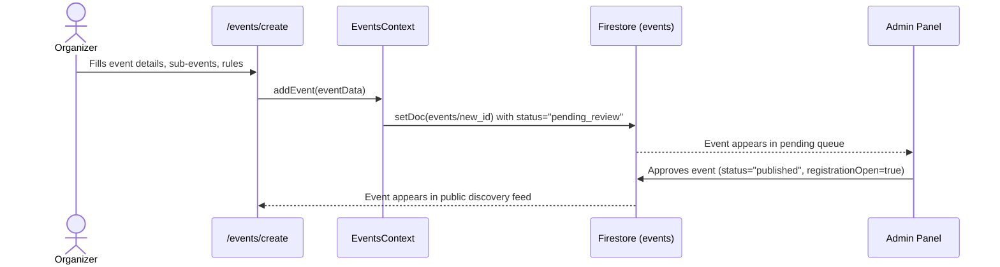
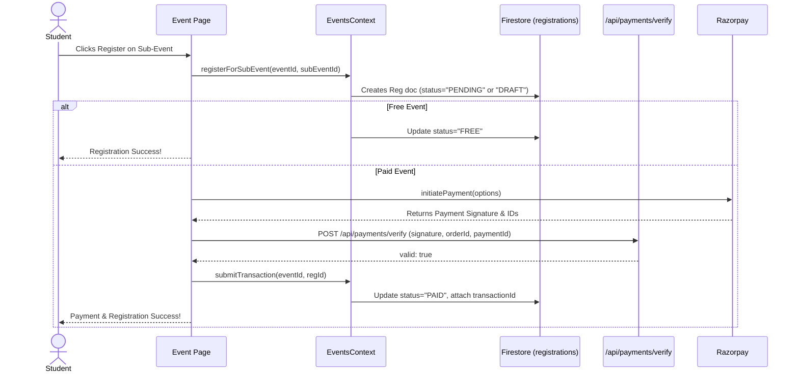

# MyFestivo Architecture Documentation

## 1. System Overview

**MyFestivo** is a two-sided marketplace designed for college event discovery, hosting, and registration. On one side, event organizers (students, faculties, or administrators) can create, manage, and monitor events, configure ticketing and capacities, assign team tasks, and broadcast announcements. On the other side, students from various colleges can browse these events, verify their college email to access intra-college exclusive events, form teams, register, process payments via Razorpay, and access an event-specific dashboard containing event chats, QR check-ins, and rules. 

## 2. Folder & File Structure

The repository is built on a Next.js (App Router) architecture with TypeScript and Tailwind CSS. 

```text
/
├── firestore.rules          # Firebase security rules restricting access to DB collections
├── src/
│   ├── app/                 # Next.js App Router root (Pages & API)
│   │   ├── admin/           # Platform analytics and event approval queue
│   │   ├── api/             # Backend endpoints (auth, emails, payments verify)
│   │   ├── dashboard/       # User dashboard showing upcoming registered events
│   │   ├── events/          # Event discovery list, creation, and detail/management pages
│   │   ├── profile/         # User profile management and college email verification
│   │   └── (auth)/          # login, signup, forgot-password flows
│   ├── components/          # Reusable React components (shadcn/ui + custom)
│   │   ├── event/           # Event specific UI (ChatPanel, ParticipantsList, etc.)
│   │   └── ui/              # Generic UI primitives (Buttons, Inputs, Modals, GlassCard)
│   ├── lib/                 # Core business logic and context providers
│   │   ├── auth-context.tsx # Firebase Auth integration, user roles, session mgmt
│   │   ├── events-context.tsx # Realtime Firestore data sync for events, registrations
│   │   ├── firebase.ts      # Client-side Firebase initialization
│   │   ├── firebase-admin.ts# Server-side Firebase admin SDK
│   │   └── razorpay.ts      # Razorpay client-side initialization and helpers
```

## 3. Data Models / Firestore Schema

### Collection: `users`
Tracks all authenticated users on the platform.
* `id` (string): Firebase Auth UID
* `email` (string), `name` (string), `phone` (string)
* `role` (string): `"admin" | "faculty" | "student"` (derived from `year` in context)
* `college` (string), `rollNo` (string), `department` (string), `year` (string)
* `collegeEmail` (string), `collegeEmailVerified` (boolean)
* `friends` (string[]), `registeredEvents` (string[]), `hostedEvents` (string[])
* **Relationships**: A user can own multiple registrations and host multiple events.
* **Access**: Written by `auth-context.tsx` upon signup. Read globally to resolve names.

#### Subcollection: `users/{uid}/friendRequests`
* Contains incoming and outgoing friend request documents.

### Collection: `events`
The core event definition managed by organizers.
* `id` (string), `title` (string), `description` (string)
* `organizerEmail` (string)
* `date` (string), `time` (string), `venue` (string), `seats` (number)
* `category` (string), `isInter` (boolean), `price` (number)
* `collegeDomain` (string): Domain constraint for intra-college events.
* `registrationOpen` (boolean), `registrationDeadline` (string)
* `status` (string): `"pending_review" | "published"`
* `subEvents` (Array of objects): Includes `type` (solo/team), `maxParticipants`, `minTeamSize`, `maxTeamSize`, `prize`.
* **Access**: Written during event creation. Updated by admins (approval) or organizers (edits). Read globally for discovery.

#### Subcollection: `events/{id}/registrations`
* `id` (string), `userId` (string), `userEmail` (string)
* `subEventId` (string)
* `status` (string): `"PAID" | "FREE" | "PENDING" | "REFUNDED" | "DRAFT"`
* `teamMembers` (string[]), `pendingMembers` (string[])
* `checkedIn` (boolean), `checkInTime` (string)
* **Access**: Created by the user registering (`events-context.tsx`). Checked-in mutated by event host/staff.

#### Subcollection: `events/{id}/chat`
* Event-specific and sub-event-specific real-time chat.
* `userId`, `userName`, `message`, `timestamp`.

#### Subcollection: `events/{id}/announcements`
* Broadcasts from organizers. `title`, `message`, `pinned`, `targetSubEventId`.

#### Subcollection: `events/{id}/tasks`
* Organizer team task delegation. `assignedTo`, `status` (`TODO`, `IN_PROGRESS`, `DONE`).

### Collection: `collegeOtps`
* Temporary storage mapping a `userId` to a generated OTP for college email verification.

### Collection: `payments`
* Secure log of Razorpay payment transactions linked to a registration.

## 4. Authentication & Authorization Flow

**Authentication Flow**
1. User signs up via Email/Password or Google OAuth (`src/app/signup/page.tsx`).
2. `auth-context.tsx` handles Firebase Auth creation, then writes the expanded profile to the `users` Firestore collection.
3. College domain verification: User enters `student@srmist.edu.in` in Profile. System generates OTP to `collegeOtps`, emails it via `api/auth/send-college-otp`, and verifies via `api/auth/verify-college-otp`.

**Authorization / Roles**
- **Student**: Default role. Can browse, register, and form teams.
- **Faculty/Staff**: Determined if `year === "Faculty/Staff"`. Blocked from registering for events (registration number replaced with "Not applicable"). Staff assigned to events get read-only access to event management tabs.
- **Admin**: Configured manually in DB (`role: 'admin'`). Accesses `/admin` to approve events, view platform analytics, and manage users.
- **Organizer (Host)**: Dynamic role based on matching `event.organizerEmail` to `user.email`. Grants full write access to the specific event's settings, tasks, and announcements.

## 5. Core User Flows

### Event Creation Flow (Organizer)


### Event Registration & Payment Flow (Student)


## 6. Business Rules & Validation Logic

- **Intra-College Restriction**: If an event has a `collegeDomain` set (e.g., `srmist.edu.in`), a user's `collegeEmail` must be verified and match that domain to view the registration button.
- **Faculty Constraints**: Faculty/Staff cannot register for events. They are blocked at the UI level (`page.tsx`) and lack registration number fields.
- **Deadline Enforcement**: Registration buttons disable if `Date.now() > event.registrationDeadline`.
- **Capacity Limits**: Sub-event registrations check `maxParticipants`.
- **Team Size**: Team registrations require members to fall between `minTeamSize` and `maxTeamSize`.
- **Check-in Constraints**: Only `PAID` or `FREE` (confirmed) registrations can be checked in via the QR scanner.
- **Task Assignments**: Only the assigned user (or the Organizer/Admin) can move a task's status to `IN_PROGRESS` or `DONE`. 

*Note [SECURITY GAP]*: Many constraints (like registration deadlines and capacity limits) are primarily enforced in the UI (`page.tsx`) and context (`events-context.tsx`) rather than in strict Firestore Security Rules. A malicious user with direct API access could potentially bypass a deadline or capacity check. Payment signature verification happens securely on the backend, but the actual database status update to `PAID` is dispatched by the client.

## 7. Firestore Security Rules

Below is the active `firestore.rules` configuration governing the application.

```javascript
rules_version = '2';
service cloud.firestore {
  match /databases/{database}/documents {
    // Helper: Check if user is admin
    function isAdmin() {
      return get(/databases/$(database)/documents/users/$(request.auth.uid)).data.role == 'admin';
    }
    
    // Helper: Check if user is event organizer
    function isEventOrganizer(eventId) {
      return get(/databases/$(database)/documents/events/$(eventId)).data.organizerEmail == request.auth.token.email;
    }

    match /users/{userId} {
      allow read: if true; // Public for coordinator name resolution
      allow create: if request.auth != null && request.auth.uid == userId;
      allow update: if request.auth.uid == userId
        || (request.auth != null
            && request.resource.data.diff(resource.data).affectedKeys()
                .hasOnly(['friendRequestsIn', 'friendRequestsOut', 'friends']));
      allow delete: if request.auth.uid == userId;
      
      match /friendRequests/{document=**} {
        allow read, write: if request.auth.uid == userId;
      }
    }

    match /events/{eventId} {
      allow read: if true; // Public event discovery
      allow create: if request.auth != null;
      allow update: if isEventOrganizer(eventId) || isAdmin()
        || (request.auth != null && (
             request.resource.data.diff(resource.data).affectedKeys().hasOnly(['chatMessages', 'registeredCount']) ||
             request.resource.data.diff(resource.data).affectedKeys().hasOnly(['tasks']) ||
             request.resource.data.diff(resource.data).affectedKeys().hasOnly(['tasks', 'chatMessages'])
           ));
      allow delete: if isEventOrganizer(eventId) || isAdmin();
      
      match /registrations/{regId} {
        allow read: if request.auth != null;
        allow create: if request.auth.uid == request.resource.data.userId;
        allow update: if isEventOrganizer(eventId) || request.auth.uid == resource.data.userId || isAdmin() ||
          (request.auth != null && request.auth.token.email in resource.data.pendingMembers && request.resource.data.diff(resource.data).affectedKeys().hasOnly(['pendingMembers', 'teamMembers'])) ||
          (request.auth != null && request.resource.data.diff(resource.data).affectedKeys().hasOnly(['checkedIn', 'checkInTime']));
        allow delete: if isEventOrganizer(eventId) || request.auth.uid == resource.data.userId || isAdmin();
      }
      
      match /chat/{messageId} {
        allow read, create: if request.auth != null;
        allow update, delete: if request.auth.uid == resource.data.userId || isAdmin();
      }
      
      match /announcements/{announcementId} {
        allow read: if request.auth != null;
        allow create, update, delete: if isEventOrganizer(eventId) || isAdmin();
      }

      match /tasks/{taskId} {
        allow read: if request.auth != null;
        allow create, delete: if isAdmin() || isEventOrganizer(eventId);
        allow update: if isAdmin() || isEventOrganizer(eventId) ||
            (request.auth != null && request.auth.token.email == resource.data.assignedTo && request.resource.data.diff(resource.data).affectedKeys().hasOnly(['status']));
      }
    }

    match /payments/{paymentId} {
      allow read: if request.auth.uid == resource.data.userId || isAdmin();
      allow write: if false; // Only written via secure backend context
    }

    match /collegeOtps/{userId} {
      allow read, write: if request.auth != null && request.auth.uid == userId;
    }
  }
}
```

## 8. API Routes / Server Actions

- **`POST /api/payments/verify`**
  - **Inputs**: `razorpay_order_id`, `razorpay_payment_id`, `razorpay_signature`, `registrationId`
  - **Outputs**: `{ valid: boolean, message: string }`
  - **Function**: Uses the Razorpay secret key (server-side) to generate an HMAC signature. Compares it against the incoming signature to verify the payment's authenticity. Rate limited.
  
- **`POST /api/auth/send-college-otp`**
  - **Inputs**: `userId`, `email`
  - **Function**: Generates a 6-digit OTP, stores it in the `collegeOtps` Firestore collection, and sends an email via the configured mailer.

- **`POST /api/auth/verify-college-otp`**
  - **Inputs**: `userId`, `otp`
  - **Function**: Compares the incoming OTP against the Firestore `collegeOtps` document. If valid, confirms verification.

- **`POST /api/email/*`**
  - Contains endpoints for sending specific transactional emails (`/registration`, `/task`, `/announcement`, `/team-invite`).

## 9. State Management

- **React State & Props**: Used for localized component states (modals, active tabs, form inputs).
- **Context API**: 
  - `AuthContext`: Centralized hub for Firebase Auth listeners (`onAuthStateChanged`). Stores the global `user` object and derived roles.
  - `EventsContext`: Sets up realtime listeners (`onSnapshot`) to the Firestore `events` collection. It automatically pushes state updates to the UI immediately when DB changes occur (e.g., chat messages arriving, check-ins updating).
- **Persistence**: Certain preferences and session markers (e.g., `mf_session_start`) are stored in `localStorage`. 

## 10. Known Gaps / TODOs

- **Client-Side Payment DB Writes**: `api/payments/verify` validates the Razorpay signature securely, but the actual database write (`updateDoc` to status `PAID`) is performed by the client browser via `submitTransaction()` in `events-context.tsx`. If the user closes the browser before the client can update Firestore, the payment is processed by Razorpay but not reflected in the database. 
- **Rule Strictness (Security)**: Capacity thresholds (seats), pricing rules, and deadline cutoffs are enforced heavily in UI and Context components, but not enforced purely at the `firestore.rules` level.
- **Stale Event State**: The Admin page relies heavily on aggregating context data for analytics, which is computed completely in memory on the client. For enormous datasets, this will cause heavy client-side performance issues and massive Firestore read bills. An aggregated `stats` collection maintained by Cloud Functions would be more scalable.
